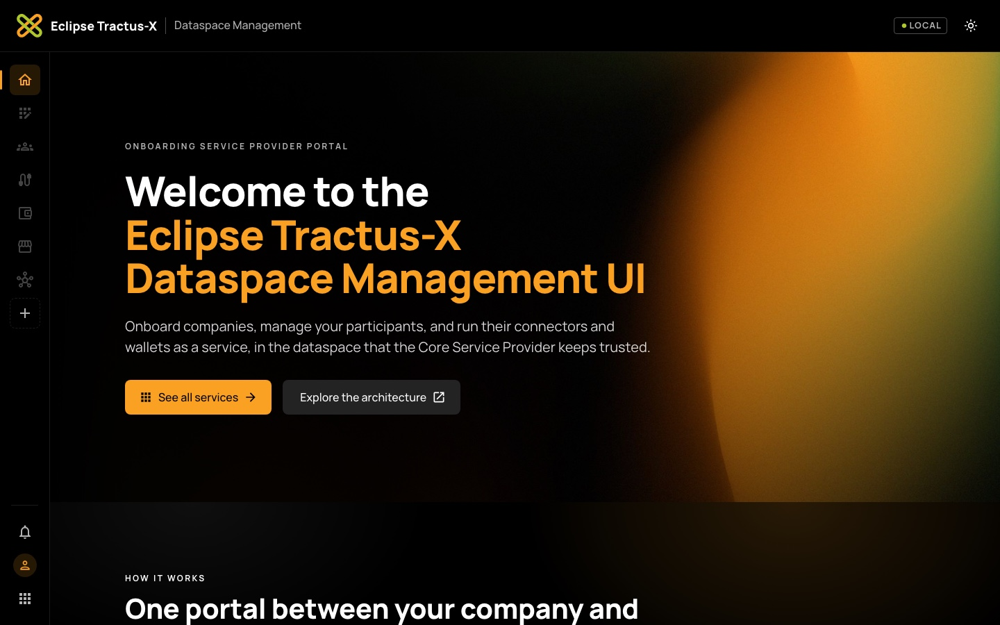
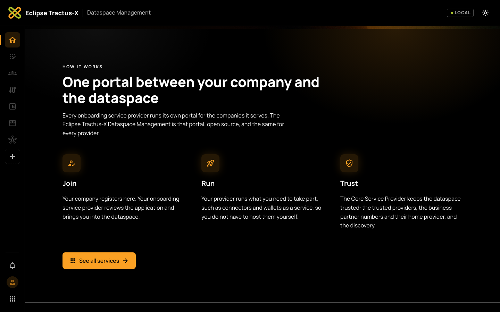
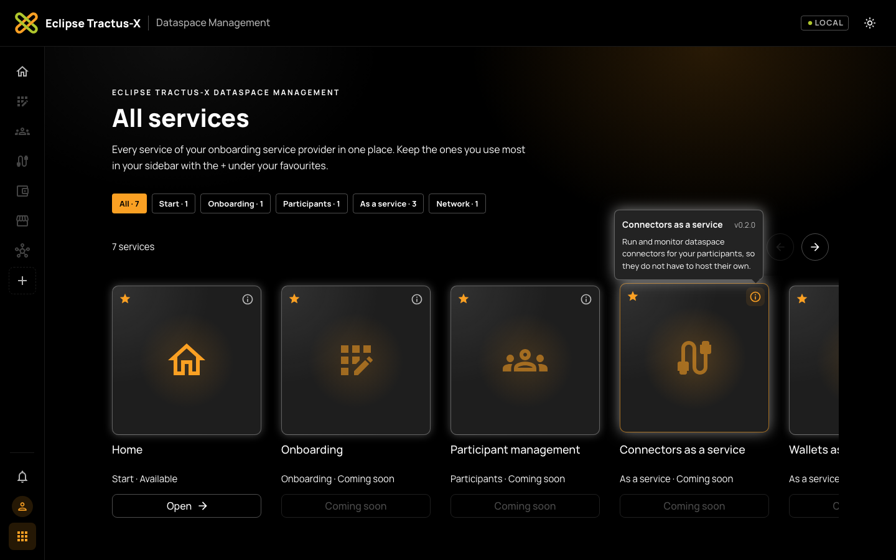
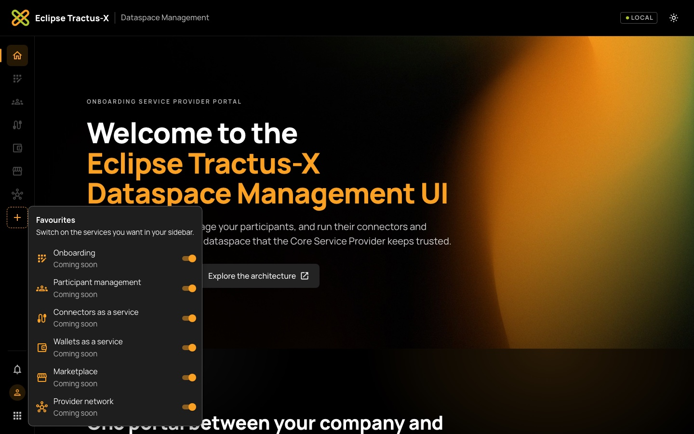
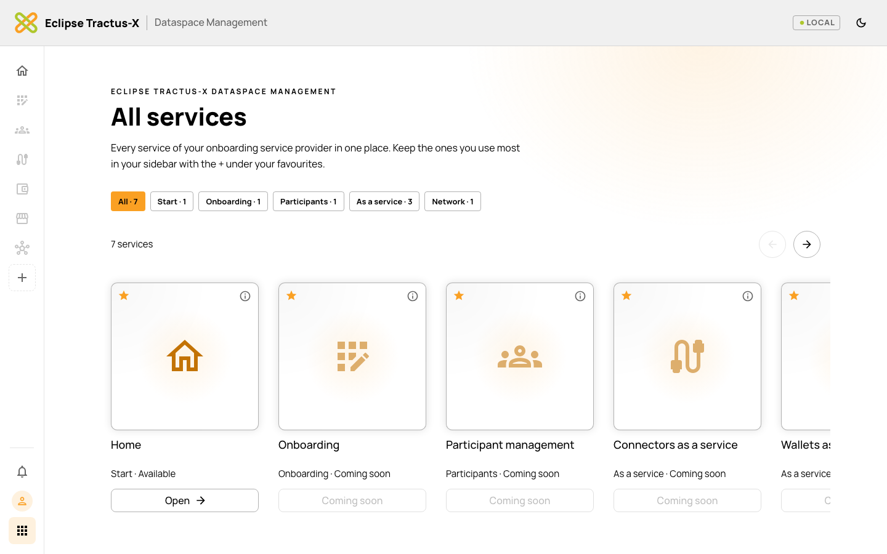
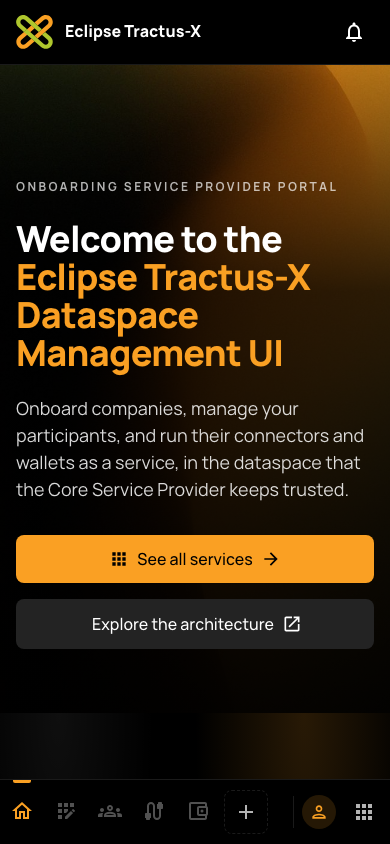
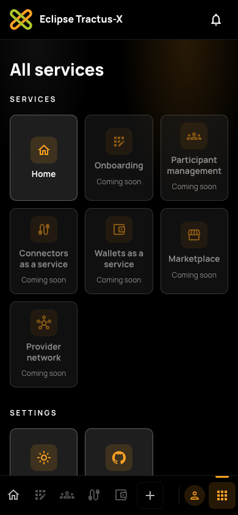

# Eclipse Tractus-X Dataspace Management UI

[](LICENSE)
[](LICENSE_non-code)
[](https://github.com/eclipse-tractusx/dataspace-mgm-ui/actions/workflows/docker-build.yml)
[](https://github.com/eclipse-tractusx/dataspace-mgm-ui/actions/workflows/codeql.yml)
[](https://github.com/eclipse-tractusx/dataspace-mgm-ui/actions/workflows/kics.yml)
[](https://github.com/eclipse-tractusx/dataspace-mgm-ui/actions/workflows/trivy.yml)
[](https://github.com/eclipse-tractusx/dataspace-mgm-ui/actions/workflows/trufflehog.yml)

The **Dataspace Management** is the modernised portal of Eclipse Tractus-X. This repository holds its user interface,
the **Dataspace Management UI**: the portal through which an onboarding service provider (OSP) and the companies it
onboards work with the [Dataspace Management Service](https://github.com/eclipse-tractusx/dataspace-mgm-service).

> **Status:** the repository is being set up. The UI is built from the frontend architecture of the Tractus-X
> Hackathon II ([tx-arena-events/portal-frontend-spec](https://github.com/tx-arena-events/portal-frontend-spec)) and
> migrated from [tx-arena-events/portal-frontend](https://github.com/tx-arena-events/portal-frontend).

## Product repositories

The leading repository of the product is [dataspace-mgm-service](https://github.com/eclipse-tractusx/dataspace-mgm-service)
(TRG 2.04). It holds the product Helm chart, the release of the product, the architecture documentation and the admin guide.

- [dataspace-mgm-service](https://github.com/eclipse-tractusx/dataspace-mgm-service): backend (leading repository)
- [dataspace-mgm-ui](https://github.com/eclipse-tractusx/dataspace-mgm-ui): user interface and end user manual (this repository)

## What it does

Every OSP runs its own installation of the Dataspace Management, including its own UI. With the UI:

- people **sign in without passwords** with their EUDI Wallet,
- a company representative **registers the company** with the Business Wallet of the company,
- OSP staff **review** the applications,
- company administrators manage the **company profile, people, technical users, connectors and subscriptions**.

The frontend is as dumb as possible: business decisions live in the backend, and Process Orchestration decides which
step comes next. The UI renders what the API returns and sends what the user enters. Live updates arrive as
Server-Sent Events. See the [architecture of the UI](docs/architecture/README.md).

## Screenshots

The portal follows the Eclipse Tractus-X design guidelines: black by default with the Eclipse Tractus-X orange as
the accent, and a light mode with the same tokens. The header stays at the top and the sidebar on the left (on
phones, a bar at the bottom). Only the page between them scrolls. The services shown are placeholders marked
"coming soon" until their backend modules arrive.

**Home**: the welcome page, and how taking part works.





**All services**: every service as a card in a carousel, filtered by area. The info button shows the description and
the version in a tooltip.



**Favourites**: the + under the last favourite in the sidebar switches services on and off in the sidebar.
Notifications, the profile and All services sit at the bottom left.



**Light mode**



**Phone**: the sidebar becomes a bar at the bottom with the first favourites, the +, the profile and All services.

<p>
  
  &nbsp;
  
</p>

## Repository structure

| Path | Content |
|---|---|
| [`docs/user`](docs/user/README.md) | End user manual |
| [`docs/architecture`](docs/architecture/README.md) | Architecture of the UI |
| [`Dockerfile`](Dockerfile), [`docker/nginx.conf`](docker/nginx.conf), [`DOCKER_NOTICE.md`](DOCKER_NOTICE.md) | Container image, nginx configuration and notice for DockerHub |
| [`charts`](charts/README.md) | Pointer to the product Helm chart in the leading repository |
| [`.github`](.github) | Workflows (build, CodeQL, KICS, Trivy, TruffleHog, Eclipse Dash), Dependabot, templates |
| [`.tractusx`](.tractusx) | Metadata file for the Tractus-X release checks |

With the source code, the Nx workspace is added at the root of the repository: `apps/` (the React apps `portal` and
`registration`), `packages/` (framework-free core packages per backend module), `libs/` (state and pages per module,
shared UI libraries), `specs/` (OpenAPI of the backend modules), `package.json` and `package-lock.json`.

## Installation

The UI is installed with the product Helm chart:

```shell
helm repo add tractusx-dev https://eclipse-tractusx.github.io/charts/dev
helm install dataspace-mgm tractusx-dev/dataspace-mgm --namespace dataspace-mgm --create-namespace
```

[INSTALL.md](INSTALL.md) describes the configuration of the UI, running the container image and local development.

## Usage

```shell
kubectl --namespace dataspace-mgm port-forward svc/dataspace-mgm-frontend 8080:8080
# -> http://localhost:8080
```

The [user manual](docs/user/README.md) describes sign-in, the registration of a company, the review of applications and
the administration of a company, per role.

### Local development

```shell
npm ci
npx nx serve portal
```

## Container images

The images are published on DockerHub: [`tractusx/dataspace-mgm-ui`](https://hub.docker.com/r/tractusx/dataspace-mgm-ui).
They are tagged with the semantic version of the release (`1.2.3`, `1.2`, `1`) and `latest` (TRG 4.01).
See the [notice for the Docker image](DOCKER_NOTICE.md) (TRG 4.06).

## Troubleshooting and FAQ

**The page shows "The portal could not start".**
The runtime configuration `/config.json` is missing or invalid. Check `frontend.config.apiBaseUrl` in the Helm values.

**I am signed out after every reload.**
UI and API must share the same registrable domain, so that the session cookie is sent to the API.

**Where are the tokens?**
Nowhere in the browser. Sign-in and session are handled by the backend; the browser only holds a session cookie.

More problems and solutions are listed in [INSTALL.md](INSTALL.md#troubleshooting).

## Contributing

Contributions are welcome. Please read [CONTRIBUTING.md](CONTRIBUTING.md) first: you need to sign the Eclipse
Contributor Agreement, and pull requests follow conventional commits. UI changes follow the
[Tractus-X UI styleguide](https://eclipse-tractusx.github.io/docs/release/trg-9/trg-9-01). Please report security
vulnerabilities as described in [SECURITY.md](SECURITY.md), never in public issues.

## Contact

- Mailing list: [tractusx-dev@eclipse.org](https://accounts.eclipse.org/mailing-list/tractusx-dev)
- Matrix chat: [Eclipse Tractus-X](https://matrix.to/#/#tractusx:matrix.eclipse.org)
- Issues: [GitHub issues](https://github.com/eclipse-tractusx/dataspace-mgm-ui/issues)
- Committers: see [AUTHORS.md](AUTHORS.md) and [CODEOWNERS](.github/CODEOWNERS)

## License

Distributed under the [Apache License 2.0](LICENSE) for code and the
[Creative Commons Attribution 4.0 International](LICENSE_non-code) license (CC-BY-4.0) for non-code.
See [NOTICE.md](NOTICE.md) for more information. The third-party dependencies and their license status are listed in
the `DEPENDENCIES` file, generated with the Eclipse Dash License Tool.

## NOTICE

This work is licensed under the [CC-BY-4.0](https://creativecommons.org/licenses/by/4.0/legalcode).

- SPDX-License-Identifier: CC-BY-4.0
- SPDX-FileCopyrightText: 2026 Contributors to the Eclipse Foundation
- Source URL: https://github.com/eclipse-tractusx/dataspace-mgm-ui
