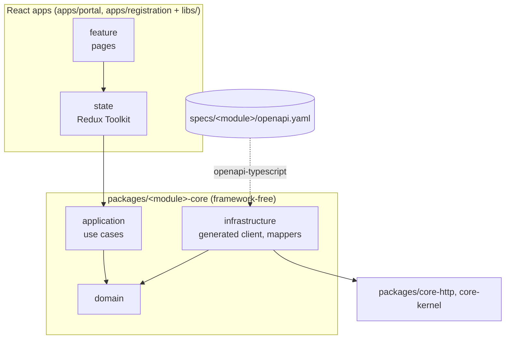

# Architecture of the Dataspace Management UI

The architecture of the product (context, modules, flows, deployment) is documented in arc42 form in the leading
repository: [dataspace-mgm-service/docs/architecture](https://github.com/eclipse-tractusx/dataspace-mgm-service/blob/main/docs/architecture/README.md).
This page summarises the architecture of the UI. The detailed frontend architecture guide (until it is moved to Eclipse
Tractus-X) is in [tx-arena-events/portal-frontend-spec](https://github.com/tx-arena-events/portal-frontend-spec/blob/main/architecture/README.md).

## The idea

The frontend is as dumb as possible: business decisions and everything OSP-specific live in the backend. The little
frontend logic that remains, which calls belong to an action, in which order, and how data is mapped, lives in
**framework-free core packages**, one per backend module, generated from the module's `openapi.yaml`. The React apps
consume them, and the UI on top stays replaceable.



## Workspace

| Folder | Content |
|---|---|
| `apps/portal`, `apps/registration` | The React apps (composition roots) |
| `packages/<module>-core` | Framework-free core package per backend module; generated types in `src/generated/` |
| `packages/core-http`, `packages/core-kernel` | Shared HTTP setup (cookies, CSRF, 401) and kernel |
| `libs/<module>/state`, `libs/<module>/feature` | UI state and pages per module |
| `libs/shared/*` | MUI wrappers (`ui-mui`), layout, feedback, i18n, runtime configuration |
| `specs/<module>/openapi.yaml` | OpenAPI of the backend modules, copied from the module's release |

Nx workspace with npm workspaces, TypeScript, React, Redux Toolkit, React Router, MUI (only inside `libs/shared/ui-mui`),
Vite, Vitest, Playwright and MSW for API mocks.

## Rules

- No business decisions in the UI: the API returns flags and step keys; Process Orchestration decides the next step.
- The UI never calls the API directly, always through a use case of a core package.
- No tokens and no Keycloak in the browser: sign-in and session are handled by the backend; the browser only has a session cookie.
- Texts are i18n keys; error and validation messages from the API are keys that the UI translates.
- Live updates via Server-Sent Events, never WebSockets and never polling.

## Runtime configuration and deployment

The UI is built **once** into one image; the same image runs in every environment. Everything that differs per
environment comes from `/config.json` at runtime, mounted from a ConfigMap of the
[product Helm chart](https://github.com/eclipse-tractusx/dataspace-mgm-service/tree/main/charts/dataspace-mgm):

```json
{ "api_base_url": "https://api.portal.example.org", "environment": "prod" }
```

The image ([Dockerfile](../../Dockerfile)) serves the static files with `nginxinc/nginx-unprivileged` on port 8080 as
user 101 with a read-only root file system ([nginx configuration](../../docker/nginx.conf)).

## UI styleguide (TRG 9.01)

The new portal does not depend on `@catena-x/portal-shared-components`; every MUI component is wrapped in
`libs/shared/ui-mui`. These wrappers implement the Tractus-X styleguide of the
[Portal Shared Components](https://eclipse-tractusx.github.io/portal-shared-components) (fonts, colours, buttons, inputs,
layout grid), so the UI stays consistent with the other Tractus-X applications. Every UI change is checked against
TRG 9.01: responsiveness, supported browsers, accessibility (WCAG 2.1), loading states, protection against double
submission, and notifications for success and errors.

## NOTICE

This work is licensed under the [CC-BY-4.0](https://creativecommons.org/licenses/by/4.0/legalcode).

- SPDX-License-Identifier: CC-BY-4.0
- SPDX-FileCopyrightText: 2026 Contributors to the Eclipse Foundation
- Source URL: https://github.com/eclipse-tractusx/dataspace-mgm-ui/blob/main/docs/architecture/README.md
