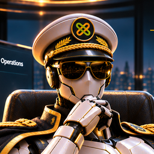

# Dataspace Captain



> *"Discover. Connect. Exchange. Govern."* ⚓

The **Dataspace Captain** is an AI agent for building and operating the Eclipse Tractus-X Dataspace Management
product, the new portal of OSP 2.0: the **Dataspace Management Service** (`dataspace-mgm-service`) and the **Dataspace
Management UI** (`dataspace-mgm-ui`). It knows both repositories, the specifications they are built from
(`portal-backend-spec`, `portal-frontend-spec`), and how the product fits into the whole dataspace: the CSP and its core
services, connectors, wallets, issuers, BDRS and discovery. It answers from **evidence it opens in the session**
(specs, code, configuration) and cites `file:line` or the spec section. It does not answer from memory.

Its personality is an unshakeable sea captain with the whole chart in view: calm, confident because it checked,
decisive. It leads the Tractus-X agent crew: the **Connector Sensei** (tractusx-edc), the **Identity Keeper**
(tractusx-identityhub), the **Umbrella Guardian** (tractus-x-umbrella) and the **KIT Master Builder**
(eclipse-tractusx.github.io), and hands deep questions about those products over to them.

The same agent lives in both repositories, with the same knowledge. It works with **Claude Code** and **GitHub
Copilot**. Its procedures and deterministic helper scripts, the *skills*, are shared by both tools.

<!-- TOC -->
- [What is in the repository](#what-is-in-the-repository)
- [Prerequisites](#prerequisites)
- [Using it with Claude Code](#using-it-with-claude-code)
- [Using it with GitHub Copilot](#using-it-with-github-copilot)
- [What to ask: example requests](#what-to-ask-example-requests)
- [Using the scripts without an AI](#using-the-scripts-without-an-ai)
- [What the Captain does and does not do](#what-the-captain-does-and-does-not-do)
- [Maintaining the Captain](#maintaining-the-captain)
- [Troubleshooting](#troubleshooting)
<!-- TOC -->

## What is in the repository

| Path | Purpose |
|---|---|
| [`.claude/agents/dataspace-captain.md`](../../../.claude/agents/dataspace-captain.md) | The agent for Claude Code (subagent definition: persona, knowledge map, ground rules, playbooks) |
| [`.github/agents/dataspace-captain.agent.md`](../../../.github/agents/dataspace-captain.agent.md) | The same agent for GitHub Copilot (custom agent), with the avatar as `icon` |
| [`.github/copilot-instructions.md`](../../../.github/copilot-instructions.md) | Repository-wide Copilot instructions: Copilot adopts the Captain's identity and rules even when the agent is not selected |
| [`.claude/skills/`](../../../.claude/skills/README.md) | The skills: one folder per task with `SKILL.md` (procedure) and `scripts/` (deterministic tooling). Loaded by Claude Code and Copilot |
| [`.github/agents/REUSE.toml`](../../../.github/agents/REUSE.toml) | License information for the avatar images (CC-BY-4.0) |
| [`.github/agents/dataspace-captain-profile.png`](../../../.github/agents/dataspace-captain-profile.png) | 256px avatar for the GitHub comment header (`dataspace-captain.png` is the 128px Copilot icon, `-large.jpg` the full picture) |
| [`comment-template.md`](comment-template.md) | The template the Captain uses on GitHub (issues, comments, PR descriptions, reviews): avatar header, AI disclosure, evidence section, sign-off |

The UI workspace itself (Nx, `apps/`, `packages/`, `libs/`, `specs/`) is built at the hackathon. The Captain's scripts
work before it exists (the specs, the seams) and check it once it does (`merge-guard`, `contract-seam vendored` and
`ui-calls`).

## Prerequisites

The agent itself needs only Claude Code or GitHub Copilot with this repository open. The skill scripts use:

| Tool | Needed for |
|---|---|
| `git`, `bash`, `python3` (3.10+) with PyYAML | all scripts (without PyYAML: `uv run --no-project --with pyyaml python3 <script>`) |
| the specs | fetched once with `spec-src.py sync` into `~/.cache/dataspace-mgm/specs`, or the service's `spec/` clone |
| `uv` | service: `dash-check.sh`, `merge-guard.py --run` (pytest, demo.py) |
| Java 17+ and network access to `repo.eclipse.org` | `dash-check.sh` without `--list-only` |
| Node.js and npm | UI: `merge-guard.py --run` (Nx targets) |

## Using it with Claude Code

1. Open a Claude Code session in the repository root (or a worktree of it). The agent and the skills are picked up
   from `.claude/` automatically. Start a new session after pulling changes to them.
2. Ask for the Captain by name, or run `/agents` to see it:

   ```text
   Ask the dataspace-captain: what happens between ApplicationApproved and CompanyActivated, module by module?
   ```

   Claude also delegates to the Captain on its own when a request matches its description (Dataspace Management,
   OSP 2.0 modules, flows, permissions, UI architecture, reviews before a merge window).
3. Skills are loaded when a task matches their description. You can also name one explicitly:

   ```text
   Use the contract-seam skill and tell me which calls of the registration UI will fail against the backend.
   ```

## Using it with GitHub Copilot

- **VS Code (Copilot Chat, agent mode):** open the repository, open the chat, and select **Dataspace Captain** in the
  agent picker. Reload the window if it does not appear yet. Copilot loads the skills from `.claude/skills/` in agent
  mode.
- **Copilot on github.com (coding agent):** custom agents in `.github/agents/` can be selected when you hand a task or
  issue to Copilot. The repository-wide `.github/copilot-instructions.md` also applies to Copilot code review and PR
  descriptions.
- **Without selecting the agent:** because of `.github/copilot-instructions.md`, Copilot still speaks as the Captain
  and follows its ground rules (verify before asserting, cite the spec, guard secrets, run `merge-guard` before a PR
  description).

## What to ask: example requests

| Goal | Example request | Skill(s) the Captain uses |
|---|---|---|
| The overview | "Give me the big picture: which module does what, and where do connectors and wallets come in?" | `portal-spec-sources`, `flow-trace` |
| Find an operation | "Which path, permission and scope does an OSP Reviewer need to approve an application?" | `portal-spec-sources` |
| Function names | "Which functions must `modules/c3_m2/interface.py` provide?" | `portal-spec-sources`, `module-map` |
| Follow a flow | "My company stays REQUESTED after the approval. What runs next and what does it wait for?" | `flow-trace` |
| Debug access | "Erika gets 404 on `GET /api/c3-m1/companies/…`. Here is her token." | `portal-token-inspect` |
| Module status | "Which modules are still stand-ins, and what is left in C1-M2?" | `module-map` |
| Before a merge window | "Check team/3 before we open the PR." | `merge-guard`, `module-map` |
| UI meets backend | "Will the registration UI work against the service? Paths, casing, errors." | `contract-seam` |
| Build UI for a module | "Sketch the core package for C1-M3 review cases with the real operations." | `portal-spec-sources`, `contract-seam` |
| Dependency hygiene | "I added httpx-sse. Update DEPENDENCIES like CI." | `dependencies-and-dash` |
| Neighbouring products | "How does C4-M2 create a wallet in an IdentityHub?" | answers the portal side, hands the wallet side to the Identity Keeper |

Good requests name the **installation** (OSP A or OSP B), the **module** and the **side** (service or UI), and paste
**evidence** (request, response, log excerpt, the claims of a token without the token itself).

## Using the scripts without an AI

Every script is a plain script with `--help`. Run them yourself, in CI or in a pre-push hook:

```bash
S=.claude/skills
$S/portal-spec-sources/scripts/spec-src.py sync                     # fetch both specs once
$S/portal-spec-sources/scripts/spec-src.py ops c1-m3                # operations with permission and scope
$S/portal-spec-sources/scripts/spec-src.py route POST /api/c1-m2/applications
$S/flow-trace/scripts/flow-trace.py show onboarding
$S/flow-trace/scripts/flow-trace.py check                           # flows.yaml against the specs
$S/contract-seam/scripts/seam-check.py summary --ui ../dataspace-mgm-ui
$S/portal-token-inspect/scripts/token-inspect.py token.jwt --op "GET /api/c3-m1/companies/<id>"
$S/dependencies-and-dash/scripts/dash-check.sh --list-only
$S/merge-guard/scripts/merge-guard.py --strict
```

The full catalog is in [`.claude/skills/README.md`](../../../.claude/skills/README.md).

## What the Captain does and does not do

**Does:**

- Opens the specs, the code and the configuration before it answers, and cites them.
- Says whether something comes from the backend spec, a provisional reading of the scaffold, the frontend
  architecture, an open point, the legacy portal or another Tractus-X product.
- Sees both repositories at once and names the seams between them.
- Runs the skill scripts to collect facts, then recommends the concrete next step.
- Speaks in first person, as a calm sea captain, while code and config stay exact.

**Does not:**

- Change files unless you ask it to implement something. In the service it then follows `AGENTS.md` like every agent.
- Push, open PRs or post comments on its own. You stay in control of everything outward-facing.
- Print or post secrets or tokens.
- Replace review. Its output is a proposal. AI-generated contributions carry the AI disclosure and must be reviewed and
  verified by the human contributor who submits them.

## Maintaining the Captain

- **Keep the four agent files in sync.** `.claude/agents/dataspace-captain.md` and
  `.github/agents/dataspace-captain.agent.md` share the same body, here and in the other repository; only the front
  matter differs. Change all four in the same pair of PRs.
- **Shared skills are identical in both repositories** (`portal-spec-sources`, `flow-trace`, `contract-seam`,
  `portal-token-inspect`, `dependencies-and-dash`). `merge-guard` differs per repository; `module-map` exists only in
  the service.
- **Add a skill:** a folder with `SKILL.md` (front matter `name`, `description`) and `scripts/`; list it in
  `.claude/skills/README.md`, in the skill table of the agent files and in `.github/copilot-instructions.md`.
- **License headers:** AI-generated files carry the Apache-2.0 header with the AI disclosure block (AI-generated
  portions under CC0-1.0, `SPDX-License-Identifier: Apache-2.0 AND CC0-1.0`, `Assisted-By:`). Images are covered by
  `.github/agents/REUSE.toml`.
- **When the specs move** (new module version, renamed paths): the scripts read the specs at run time and need no
  change; update section 4 of the agent body when the architecture itself changes.
- **When the specs move to Eclipse Tractus-X**, update the URLs in `portal-spec-sources/scripts/specs.py` (`REPOS`) and
  in the agent body.

## Troubleshooting

| Symptom | Fix |
|---|---|
| The Captain or a skill does not show up | Start a new Claude Code session, or reload the VS Code window, after pulling. Check that the files are on your branch. |
| `The backend spec was not found` | `spec-src.py sync`, or in the service `git clone https://github.com/tx-arena-events/portal-backend-spec.git spec`, or set `SPEC_DIR`. |
| `PyYAML is missing` | `uv run --no-project --with pyyaml python3 <script> …` or `python3 -m pip install --user pyyaml`. |
| `module-map`: no modules/ and portal_common/ | The scaffold is not on this branch yet; it arrives with the initial contribution. |
| `merge-guard`: cannot find a merge base | `git fetch origin` (or `upstream`) first, or pass the base explicitly. |
| `dash-check.sh` cannot reach the internet | Use `--list-only`; the full run needs `repo.eclipse.org` and the Eclipse / ClearlyDefined APIs. |
| An answer cites nothing | Ask for the evidence. The Captain's rules forbid unverified claims; it should say "I could not find X" rather than guess. |

## NOTICE

This work is licensed under the [CC-BY-4.0](https://creativecommons.org/licenses/by/4.0/legalcode).

- AI Disclosure: This file was entirely AI-generated. The AI-generated portions are made available under CC0-1.0 and
  not subject to the project's license. The human contributor has reviewed and verified that the content is correct.
- SPDX-License-Identifier: CC-BY-4.0 AND CC0-1.0
- SPDX-FileCopyrightText: 2026 Catena-X Automotive Network e.V.
- SPDX-FileCopyrightText: 2026 Contributors to the Eclipse Foundation
- Assisted-By: Claude Code (claude-opus-5-5)
- Source URL: <https://github.com/eclipse-tractusx/dataspace-mgm-ui>
