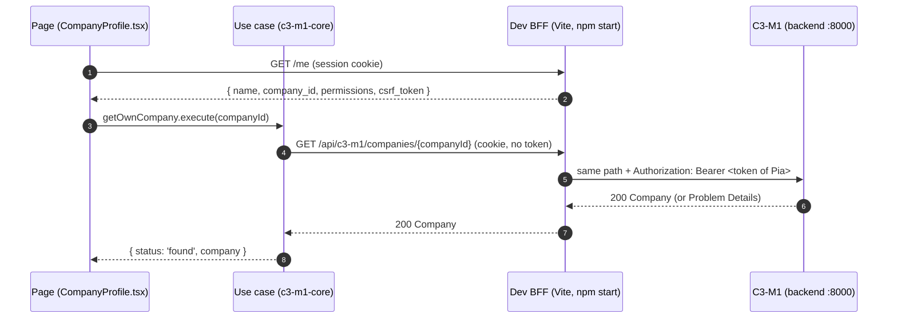

<!--
 Copyright (c) 2026 Catena-X Automotive Network e.V.
 Copyright (c) 2026 Contributors to the Eclipse Foundation

 AI Disclosure: This file was entirely AI-generated.
 The AI-generated portions are made available under CC0-1.0 and not subject
 to the project's license. The human contributor has reviewed and verified
 that the content is correct.

 SPDX-License-Identifier: CC-BY-4.0 AND CC0-1.0
 Assisted-By: Claude Code (claude-opus-5-5)
-->

# Hackathon: connect the UI to a backend module

This guide shows how a page of the portal calls a module of the
[Dataspace Management Service](https://github.com/eclipse-tractusx/dataspace-mgm-service). The example is already in
the repository: **Participant management → Your company** reads the company of the signed-in person from
**C3-M1 Company Profile** (`GET /api/c3-m1/companies/{companyId}`). Copy its pattern for your team's module.

## 1. Run it (about 5 minutes)

You need two checkouts side by side, `dataspace-mgm-service` and `dataspace-mgm-ui`, plus `uv`, Node 24 and npm.

**Terminal 1, the backend** (OSP A on port 8000). The quick way, without Docker, uses the in-memory IAM of the scaffold:

```bash
cd dataspace-mgm-service
git clone https://github.com/tx-arena-events/portal-backend-spec.git spec   # once, read-only
uv sync
SETTINGS_FILE=config/osp-a/installation.json BASE_URL=http://localhost:8000 \
  uv run uvicorn --factory scaffold.app:create_app --port 8000
```

The same as the hackathon guide, with Keycloak (needed by the teams of C2-M2 and C2-M3):
`docker compose up -d && uv run python demo.py --serve`.

**Terminal 2, the UI**:

```bash
cd dataspace-mgm-ui
npm ci
npm start            # http://localhost:4200/participants
```

You are signed in as **Pia Provider**, Company Admin of the OSP company of OSP A, and the page shows
*OSP A Beispiel GmbH* with its business partner number `BPNL00000000OSPA`.

Change the person with `http://localhost:4200/auth/login?person=<key>&return_to=/participants`. The keys are the
test persons of the backend (`testdata/persons-osp-a.json`): `erika` has no company yet (the page says so),
`otto` is OSP Admin. *Sign out* in the profile menu shows the signed-out state.

## 2. What happens on one call



- **The browser never holds a token.** The rule of the UI architecture: the BFF (the server part of the UI) keeps the
  session and adds the token on its way to the module. The real BFF does not exist yet, so `npm start` runs a small
  **dev BFF** inside the Vite dev server ([apps/portal/dev-bff/dev-bff.ts](../../apps/portal/dev-bff/dev-bff.ts)). It
  gets the token of a test person from the test Portal IAM of the backend and offers the endpoints the UI expects:
  `GET /me`, `GET /auth/login`, `POST /auth/logout` and `/api/**`. It is not in the image.
- **The page never calls HTTP.** It calls a **use case** of the module's **core package**
  ([packages/c3-m1-core](../../packages/c3-m1-core)); ESLint stops `openapi-fetch` imports in the app.
- **Types come from the spec.** `packages/c3-m1-core/src/generated/c3-m1-api.d.ts` is generated from
  `specs/c3-m1/openapi.yaml`. A wrong path or field does not compile.
- **Errors are data.** The module answers errors as Problem Details (RFC 9457); the use case returns
  `found | no-company | not-found | failed`, and the page renders each case. Try it: stop the backend and reload.

## 3. Do the same for your module

Replace `c3-m1` by your module (e.g. `c8-m1`) and `getOwnCompany` by the operation of your page.

| Step | What | Where (example) |
|---|---|---|
| 1 | Copy the module's `openapi.yaml` from the backend spec | `specs/c3-m1/openapi.yaml` (from `spec/C3-M1-CompanyProfile/`) |
| 2 | Create the core package: copy `packages/c3-m1-core`, rename it, add the alias to `tsconfig.base.json` and `workspace.aliases.ts` | `packages/c3-m1-core/project.json` |
| 3 | Generate the types (never edit them) | `npx nx run c3-m1-core:generate-api` |
| 4 | Domain: the anemic the page shows, the port with only the methods you need, an in-memory adapter | `src/domain/anemics/company.anemic.ts`, `src/domain/repositories/company.repository.ts` |
| 5 | Application: one use case per operation, reads included; expected outcomes as a result union | `src/application/useCases/get-own-company.use-case.ts` |
| 6 | Infrastructure: the HTTP adapter with the generated client and a mapper DTO → anemic | `src/infrastructure/repositories/company-http.repository.ts` |
| 7 | Public API: `create<Module>Module(config)` in `index.ts`, test helpers in `testing.ts` | `src/index.ts` |
| 8 | Wire it once in the app | [apps/portal/src/core/container.ts](../../apps/portal/src/core/container.ts) |
| 9 | Build the feature: a hook that calls the use case, the page, `routes.tsx`, register it in `features/main.tsx` | [apps/portal/src/features/participants](../../apps/portal/src/features/participants) |
| 10 | Test the use case with the in-memory adapter, the adapter with a fake `fetch`, the page with `testCoreModules()` | `*.test.ts(x)` next to the code |

Then `npm run lint && npm run typecheck && npm test` and try it in the browser against the backend.

### Tips

- **Base path:** every module is served under `/api/<module>` (the `servers.url` of its spec). The generated paths start
  after it, so the client of C3-M1 has the base URL `<api_base_url>/c3-m1`.
- **Permissions and scope:** the module checks them (`x-permission`, `x-permission-scope` in the spec). A person
  without the permission gets 403; a company that is not the person's own gives 404 in the scope `company`. Pick a test
  person who has the permission (`/me` lists them).
- **Write requests** (POST, PATCH, DELETE) need the CSRF token of the session. `createCoreClient` sends it from
  `CsrfTokenStore`; the dev BFF refuses a write without it with 403 `urn:dev-bff:problem:csrf`.
- **501 Not Implemented** means the stand-in of the module does not cover the operation yet. That is where the backend
  team of the module comes in; the UI renders the error until then.
- **No backend at hand:** `VITE_USE_MOCKS=true npm start` runs the portal on the in-memory adapters
  (`apps/portal/src/core/mock-container.ts`), signed in as Pia. A page built before its module is connected is a proof
  of concept: `stage: 'poc'` in its `routes.tsx` opens it only in mock mode.
- **Live updates** (Server-Sent Events, e.g. `GET /api/c11-m1/notifications/events`) go through the same proxy.

### Settings of the dev BFF

In the environment or in `apps/portal/.env.local` (git-ignored, see `apps/portal/.env.example`):

| Variable | Default | Meaning |
|---|---|---|
| `DEV_BFF_API_URL` | `http://localhost:8000` | The installation (OSP A; OSP B of `demo.py --serve` is `:8001`) |
| `DEV_BFF_PERSON` | `pia` | Test person signed in by default |
| `DEV_BFF_REALM` | `CX-Central` | Realm of the Portal IAM (`CX-Central-B` for OSP B) |
| `DEV_BFF_SERVICE_DIR` | `../dataspace-mgm-service` | Backend checkout, for `iam/test/get-token.py` when Keycloak runs |
| `DEV_BFF_TOKEN_COMMAND` | — | Your own command that prints a token; `{person}` and `{realm}` are replaced |
| `DEV_BFF_TOKEN` | — | A fixed token (it expires after a few minutes) |

The dev BFF first asks the in-memory IAM of the installation (`/auth/realms/<realm>/test/tokens/<person>`), then
runs `uv run python iam/test/get-token.py <person>` in `DEV_BFF_SERVICE_DIR` (Keycloak).

## Troubleshooting

| Symptom | Fix |
|---|---|
| "The backend does not answer at http://localhost:8000" | Start the backend (step 1) or set `DEV_BFF_API_URL`. |
| "No token for …: set DEV_BFF_SERVICE_DIR" | The backend runs with Keycloak; point `DEV_BFF_SERVICE_DIR` to your backend checkout. |
| 401 `urn:<module>:problem:unauthorized` | Signed out, or the token is from another installation (OSP B token at OSP A). |
| 404 for your own data | The person has no such object yet; run the scenarios first (`uv run python demo.py --no-start --scenarios 1`). |
| A page calls `/api/...` but nothing reaches the backend | Only `npm start` has the dev BFF; `npm run preview` and the image do not. |

## NOTICE

This work is licensed under the [CC-BY-4.0](https://creativecommons.org/licenses/by/4.0/legalcode).

- SPDX-License-Identifier: CC-BY-4.0
- SPDX-FileCopyrightText: 2026 Contributors to the Eclipse Foundation
- Source URL: https://github.com/eclipse-tractusx/dataspace-mgm-ui/blob/main/docs/developers/integrate-a-backend-module.md
